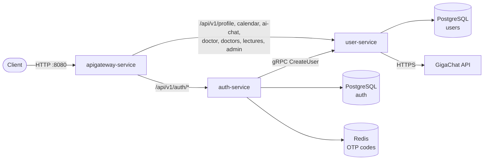
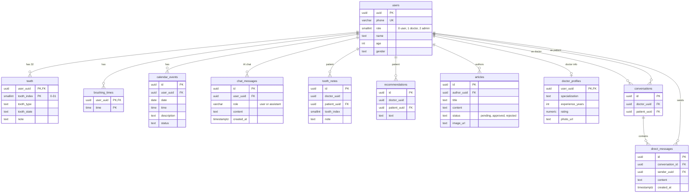

# Zub — Dental Health Backend


<!-- TODO: after the repo is created, add:
[](https://github.com/<your-org>/<your-repo>/actions/workflows/ci.yml)
and a license badge -->

Backend for **Zub**, a dental health app. Three Go microservices sit behind a single API Gateway and provide phone-based authentication, patient dental profiles, an AI assistant, a calendar, doctor–patient messaging, and a moderated library of articles.

> [!WARNING]
> **Development build.** No SMS provider is integrated yet: the one-time code is always **`1234`** for every phone number, so anyone who knows a phone number can log in as that user. Do not expose this build to the public internet as it is. See [Known limitations](#known-limitations).

## Features

- **Phone OTP authentication** — JWT access + refresh tokens
- **Patient profile** — personal data, a 32-tooth chart (type and state of every tooth) and a tooth-brushing schedule
- **Calendar** — personal calendar events
- **AI dental assistant** — chat limited to dental topics, with persistent history (GigaChat provider)
- **Doctors** — list of doctors, per-tooth notes, recommendations for patients
- **Direct messaging** — one conversation thread per doctor–patient pair
- **Lectures (articles)** — doctors submit articles, admins approve or reject them, everyone reads the approved ones
- **Role-based access** — `user`, `doctor`, `admin`
- **OpenAPI spec + Swagger UI** out of the box

## Architecture



| Service | Responsibility | Storage |
| --- | --- | --- |
| **apigateway-service** | Single entry point: proxies requests to auth-service and user-service. Role checks (doctor/admin) are done by user-service | — |
| **auth-service** | OTP sending/verification, token issuing and refresh. On a user's first login it calls `user-service` over gRPC to create their profile | PostgreSQL (`auth`), Redis |
| **user-service** | Profiles, teeth, brush schedule, calendar, AI chat, doctor features, messaging, articles | PostgreSQL (`users`) |

Shared code (JWT helpers, HTTP utilities, errors, common entities, generated protobuf code, Postgres client) lives in [`shared/`](shared).

## Tech stack

- **Language:** Go 1.25, multi-module [workspace](https://go.dev/ref/mod#workspaces) (`go.work`)
- **HTTP:** [chi](https://github.com/go-chi/chi) router; configuration with [viper](https://github.com/spf13/viper) and [godotenv](https://github.com/joho/godotenv)
- **Service-to-service:** gRPC / Protocol Buffers
- **Databases:** PostgreSQL 16, Redis 7
- **Auth:** JWT (access + refresh tokens), phone OTP
- **AI:** GigaChat
- **Infrastructure:** Docker, Docker Compose, Swagger UI

## Project structure

The repository is a Go workspace: every service and `shared` is a separate Go module, listed in `go.work`.

```
.
├── api/                    # OpenAPI specification
├── apigateway-service/     # API Gateway (routing, JWT middleware)
├── auth-service/           # OTP auth, tokens
│   ├── api/dto/            #   request/response DTOs
│   ├── cmd/                #   entrypoint
│   ├── internal/           #   config, controller, entity, service, storage (postgres, redis), usecase
│   ├── migrations/         #   SQL migrations
│   └── pkg/clients/        #   gRPC, Redis and SMS clients
├── user-service/           # Profiles, calendar, AI chat, doctors, messaging, articles
│   ├── api/dto/
│   ├── cmd/
│   ├── internal/           #   config, controller (http + grpc), service, storage (postgres), usecase
│   ├── migrations/
│   └── pkg/clients/ai/     #   AI provider client
├── shared/                 # Code shared between services (jwt, http, errors, entities, pb, postgres)
├── e2e/                    # End-to-end tests (run against a live docker compose stack)
├── docker-compose.yml
└── Makefile                # Common dev commands (run `make help`)
```

Each service has its own `Dockerfile` (`<service>/Dockerfile`); the build context is the repository root because the services depend on `shared/`.

## Quick start

### Requirements

- [Docker](https://www.docker.com/products/docker-desktop/) with Docker Compose v2
- (optional, for development) Go 1.25+ and `make`

### Run

```bash
git clone https://github.com/<your-org>/<your-repo>.git
cd <your-repo>

# Optional: override defaults (see "Configuration")
export JWT_SECRET="replace-with-a-long-random-string"
export GIGACHAT_AUTHORIZATION_KEY="<your GigaChat key>"   # needed for the AI chat

make up          # same as: docker compose up --build -d
```

The first start takes about 30 seconds while images are built. After that:

| What | URL |
| --- | --- |
| API (via gateway) | http://localhost:8080 |
| Swagger UI | http://localhost:8081 |

Stop the stack:

```bash
make down        # keep data
make clean       # also delete database and Redis volumes
```

### First request

1. Request an OTP code (no SMS is sent — see the warning at the top):

   ```bash
   curl -X POST http://localhost:8080/api/v1/auth/send_code \
     -H 'Content-Type: application/json' \
     -d '{"phone": "+79991234567"}'
   ```

2. Exchange the code (`1234`) for tokens:

   ```bash
   curl -X POST http://localhost:8080/api/v1/auth/verify_code \
     -H 'Content-Type: application/json' \
     -d '{"phone": "+79991234567", "code": "1234"}'
   ```

3. Call protected endpoints:

   ```bash
   curl http://localhost:8080/api/v1/profile/ \
     -H 'Authorization: Bearer <access_token>'
   ```

Token lifetimes by default: access token **15 minutes**, refresh token **24 hours**.

## API

The OpenAPI contract is in [`api/openapi.yaml`](api/openapi.yaml). The easiest way to explore it is Swagger UI at http://localhost:8081.

All requests go through the gateway at `http://localhost:8080`. Protected endpoints require `Authorization: Bearer <access_token>`.

**Roles:** `0` = user, `1` = doctor, `2` = admin.

Every new user is created with role `0`. The role is embedded in the JWT, and there is no API for changing it, so doctors and admins are created directly in the databases (see [Creating a doctor or an admin](#creating-a-doctor-or-an-admin)).

**Enumerations used in requests and responses:**

| Field | Values |
| --- | --- |
| Gender | `Male`, `Female` |
| Tooth type | `Molar`, `Missing`, `Milk` |
| Tooth state | `Healthy`, `Problematic`, `Missing` |
| Calendar event status | `VISITED_DOCTOR`, `PLANNED_VISIT`, `CONDITION_CHANGE_PROBLEM`, `CONDITION_CHANGE_SOLUTION`, `BRUSH_CHANGE` |
| Article status | `pending`, `approved`, `rejected` |
| AI chat message role | `user`, `assistant` |

| Area | Endpoints | Access |
| --- | --- | --- |
| **Auth** | `POST /api/v1/auth/send_code`<br>`POST /api/v1/auth/verify_code`<br>`POST /api/v1/auth/refresh_token` | Public |
| **Profile** | `GET`, `PATCH /api/v1/profile/`<br>`GET`, `PATCH /api/v1/profile/teeth`<br>`GET`, `PUT /api/v1/profile/brush-schedule` | Any authenticated user |
| **Patient messaging** | `GET`, `POST /api/v1/profile/conversations`<br>`GET`, `POST /api/v1/profile/conversations/{conversation_id}/messages` | Any authenticated user |
| **Calendar** | `GET`, `POST /api/v1/calendar/events`<br>`DELETE /api/v1/calendar/events/{event_id}` | Any authenticated user |
| **Doctors list** | `GET /api/v1/doctors/` | Any authenticated user |
| **AI assistant** | `POST /api/v1/ai-chat/message`<br>`POST /api/v1/ai-chat/greet`<br>`GET /api/v1/ai-chat/history` | Any authenticated user |
| **Doctor: patients** | `GET /api/v1/doctor/patients/{patient_uuid}`<br>`GET /api/v1/doctor/patients/{patient_uuid}/teeth` | Doctor |
| **Doctor: tooth notes** | `GET`, `POST /api/v1/doctor/patients/{patient_uuid}/teeth/notes`<br>`PUT`, `DELETE /api/v1/doctor/patients/{patient_uuid}/teeth/notes/{note_id}` | Doctor |
| **Doctor: recommendations** | `GET`, `POST /api/v1/doctor/patients/{patient_uuid}/recommendations` | Doctor |
| **Doctor: messaging** | `POST /api/v1/doctor/patients/{patient_uuid}/conversations`<br>`GET /api/v1/doctor/conversations`<br>`GET`, `POST /api/v1/doctor/conversations/{conversation_id}/messages` | Doctor |
| **Lectures** | `GET /api/v1/lectures/` (approved articles)<br>`POST /api/v1/doctor/lectures/` (created as `pending`) | Any user / Doctor |
| **Lectures moderation** | `GET /api/v1/admin/lectures/`<br>`PATCH /api/v1/admin/lectures/{article_id}/approve`<br>`PATCH /api/v1/admin/lectures/{article_id}/reject` | Admin |

All errors have the same shape (for 5xx the message is a generic `internal server error`, details are in the container logs):

```json
{ "message": "description of the error" }
```

`send_code` does not validate the phone format; the E.164 check (and the 4-digit code check) happens in `verify_code`.

### Internal gRPC API

`auth-service` calls `user-service` (port `50051`) when a user logs in for the first time:

```protobuf
syntax = "proto3";
package pb;
option go_package = "shared/api/pb;api";

service UserService {
  rpc CreateUser (CreateUserRequest) returns (CreateUserResponse);
}

message CreateUserRequest {
  string uuid = 1;
  string phone = 2;
  int32 role = 3;
}

message CreateUserResponse {
  bool ok = 1;
  string error_message = 2;
}
```

Failures are reported inside the response (`ok = false` plus `error_message`), not as a gRPC status error, so callers must check `ok`.

Generated Go code is in [`shared/api/pb`](shared/api/pb).

## Configuration

Services read environment variables. When started outside Docker they also load a `.env` file from the working directory, which is convenient for running a single service locally. Anything not set falls back to the defaults below. `docker-compose.yml` already sets everything needed for local development.

### Set on the command line / in `.env` for Docker Compose

| Variable | Default | Description |
| --- | --- | --- |
| `JWT_SECRET` | `change-me-in-production` | Secret used to sign and verify JWTs. Shared by all three services |
| `GIGACHAT_AUTHORIZATION_KEY` | *(empty)* | GigaChat authorization key for the AI assistant |

### auth-service

| Variable | Default | Description |
| --- | --- | --- |
| `ENV_TYPE` | `local` | Environment type: `local`, `dev` or `prod` |
| `RUN_PORT` | `8080` | HTTP port |
| `GRPC` | `user-service:50051` | Address of user-service gRPC |
| `DATABASE_HOST`, `DATABASE_USER`, `DATABASE_PASSWORD`, `DATABASE_NAME` | — | PostgreSQL connection |
| `CACHE_HOST`, `CACHE_PORT`, `CACHE_PASSWORD` | — | Redis connection (OTP storage) |
| `JWT_SECRET` | — | JWT signing secret |
| `ACCESS_TOKEN_TTL` | `15m` | Access token lifetime |
| `REFRESH_TOKEN_TTL` | `24h` | Refresh token lifetime |
| `VERIFICATION_CODE_TTL` | `5m` | OTP lifetime |

### user-service

| Variable | Default | Description |
| --- | --- | --- |
| `ENV_TYPE` | `local` | Environment type |
| `RUN_PORT` | `8081` | HTTP port |
| `GRPC_PORT` | `50051` | gRPC port |
| `DATABASE_HOST`, `DATABASE_USER`, `DATABASE_PASSWORD`, `DATABASE_NAME` | — | PostgreSQL connection |
| `JWT_SECRET` | — | JWT signing secret |
| `ACCESS_TOKEN_TTL` | `15m` | Access token lifetime |
| `GIGACHAT_AUTHORIZATION_KEY` | — | GigaChat authorization key |
| `GIGACHAT_SCOPE` | `GIGACHAT_API_PERS` | GigaChat API scope |

### apigateway-service

| Variable | Default | Description |
| --- | --- | --- |
| `ENV_TYPE` | `local` | Environment type |
| `RUN_PORT` | `8080` | HTTP port |
| `AUTH_SERVICE_URL` | — | Upstream auth-service, e.g. `http://auth-service:8080` (required) |
| `USER_SERVICE_URL` | — | Upstream user-service, e.g. `http://user-service:8081` (required) |
| `JWT_SECRET` | — | JWT secret used to validate tokens (must match the other services) |

> [!WARNING]
> The default database/Redis passwords and `JWT_SECRET` in `docker-compose.yml` are for **local development only**. Change them before deploying anywhere.

### Creating a doctor or an admin

1. Log in once with the phone number (so the user exists), then promote it (`1` = doctor, `2` = admin) in both databases:

   ```bash
   PHONE='+79991234567'

   docker compose exec auth-postgres psql -U postgres -d auth \
     -c "UPDATE users SET role = 1 WHERE phone = '$PHONE';"
   docker compose exec user-postgres psql -U postgres -d users \
     -c "UPDATE users SET role = 1 WHERE phone = '$PHONE';"
   ```

2. For doctors, add a public profile so they appear in `GET /api/v1/doctors/`:

   ```bash
   docker compose exec user-postgres psql -U postgres -d users -c \
     "INSERT INTO doctor_profiles (user_uuid, specialization, experience_years)
      SELECT uuid, 'Dentist', 5 FROM users WHERE phone = '$PHONE'
      ON CONFLICT DO NOTHING;"
   ```

3. Log in again (`send_code` → `verify_code`) to get a token with the new role.

## Database

The system uses two PostgreSQL databases (plus Redis for OTP codes):

- **`auth`** (auth-service) — a single table `users(uuid, phone, role, created_at, updated_at)`.
- **`users`** (user-service) — profile and domain data, described below.



### Migrations

Each service keeps plain SQL migrations in its `migrations/` directory (`<timestamp>_<name>.up.sql`). The `users` database currently has nine of them (users/teeth/brushing times, doctor tables, AI chat, direct messages, tooth note, calendar, articles, article image, doctor profiles).

In the provided `docker-compose.yml` the migration files are mounted into `/docker-entrypoint-initdb.d/` of the Postgres containers, so the schema is created automatically **on the first start with an empty volume**. When you add a migration, mount it in `docker-compose.yml` as well and recreate the volume (`make clean && make up`), or apply it manually.

## Development

Common commands are in the `Makefile` (run `make help` for the full list):

| Command | Description |
| --- | --- |
| `make up` / `make down` | Start / stop the stack in Docker |
| `make clean` | Stop the stack and delete all volumes |
| `make logs` | Follow logs of all containers |
| `make build` | Compile all modules |
| `make vet` | Run `go vet` on all modules |
| `make fmt` | Format the code with `gofmt` |
| `make test` | Run unit tests of all modules |
| `make e2e` | Run end-to-end tests against the running stack |

## Testing

```bash
# unit tests (all modules except e2e)
make test

# end-to-end tests: need a running stack on http://localhost:8080
make up
make e2e
```

The e2e tests in [`e2e/`](e2e) talk to the real API through the gateway, so the stack must be up. They rely on the fixed OTP `1234` and use random phone numbers, so they can be run repeatedly against the same database.

Pull requests are checked by GitHub Actions (`.github/workflows/ci.yml`): build, `go vet`, unit tests, and e2e tests against `docker compose`.

## Known limitations

- **No SMS provider.** The OTP code is always `1234`; `auth-service` has an SMS client package, but it is not connected to a real provider. A real integration is required before any production use.
- **AI assistant** requires `GIGACHAT_AUTHORIZATION_KEY`.
- Migrations are applied only on the first start of the database container; there is no migration runner yet.

## Contributing

Contributions are welcome!

1. Fork the repository and create a branch: `git checkout -b feature/my-feature`
2. Make your changes and add tests where it makes sense
3. Run `make fmt vet test` (and `make e2e` if you touched the API)
4. If you change the HTTP API, update `api/openapi.yaml`
5. Open a pull request describing what and why

## License

This project is licensed under the [MIT License](LICENSE).
